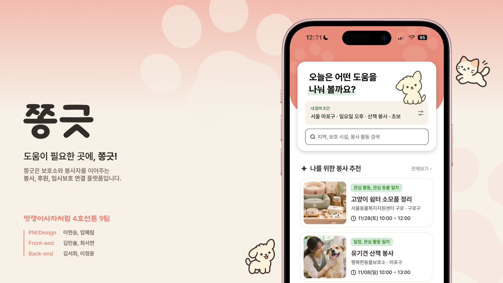
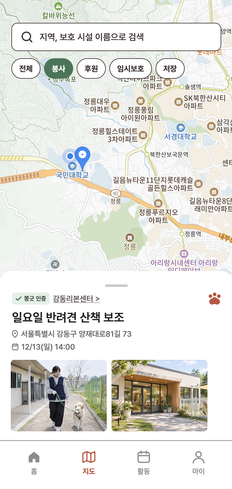
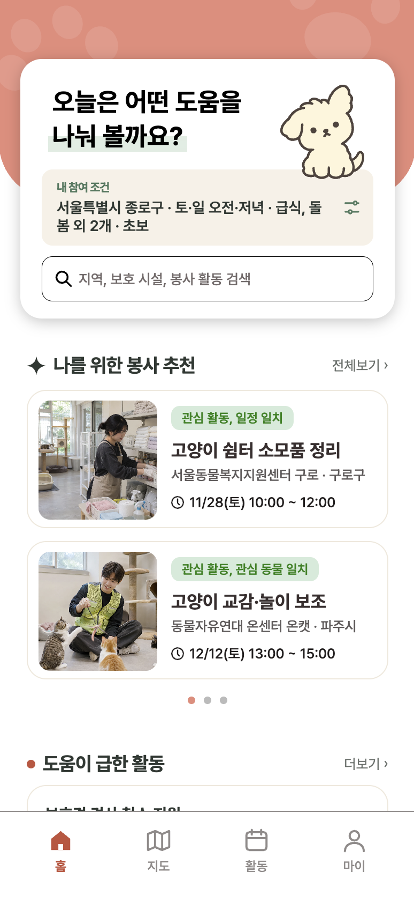
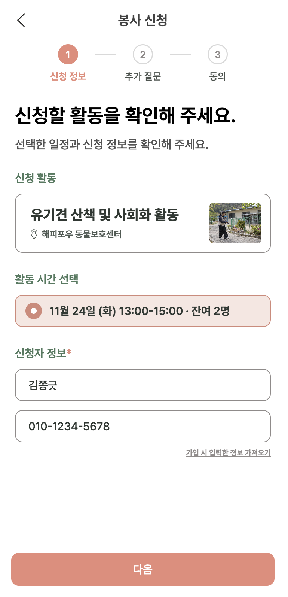

<div align="center">



# 쫑긋 · Backend

### 도움이 필요한 곳에, 쫑긋!

도움을 주고 싶은 마음이, 실제 참여로 이어질 수 있도록.<br />
**유기동물 보호시설과 사람을 잇는 봉사·후원·임시보호 연결 플랫폼**


<br /><br />

<a href="#service">서비스 소개</a> ·
<a href="#features">주요 기능</a> ·
<a href="#screens">서비스 화면</a> ·
<a href="#tech">기술 스택</a> ·
<a href="#team">백엔드 팀</a>

<br /><br />

</div>

<br />

<a id="service"></a>

## 🐾 쫑긋을 소개합니다

**“유기동물을 돕고 싶은데, 어디서부터 시작해야 할까요?”**

보호시설마다 흩어져 있는 모집 정보, 서로 다른 참여 조건과 신청 방법.<br />
쫑긋은 이 과정을 한곳으로 모아 **발견부터 신청, 참여 이후의 기록까지** 이어줍니다.

내 주변의 보호시설을 살펴보고, 나의 일정과 관심사에 맞는 활동을 찾아보세요.<br />
봉사가 처음이어도, 직접 방문하기 어려워도, 나에게 맞는 방식으로 마음을 전할 수 있습니다.

| 🐕 봉사로 함께하기 | 🎁 후원으로 마음 전하기 | 🏡 임시보호로 곁에 있기 |
| :---: | :---: | :---: |
| 산책·청소·급식·돌봄 등<br />가능한 활동과 일정을 찾아 신청해요. | 필요한 물품과 모집 현황을 확인하고<br />시설의 공식 후원 경로로 연결돼요. | 보호동물의 정보와 돌봄 조건을 살펴보고<br />임시보호 참여를 문의해요. |

<br />

<a id="features"></a>

## ✨ 마음에서 참여까지

### 01. 나에게 맞는 활동을 발견해요

관심 동물과 활동, 가능한 지역과 일정을 설정하면 참여 조건에 맞는 봉사를 추천받을 수 있어요.<br />
**추천 이유도 함께 확인**하고, 도움이 시급한 긴급 모집 공고도 살펴보세요.

### 02. 가까운 보호시설과 필요한 도움을 찾아요

지도와 검색으로 주변 보호시설을 탐색하고, 봉사·후원·임시보호 공고를 한곳에서 비교해요.<br />
시설의 운영 정보, 보호동물 현황, 모집 조건을 확인하고 관심 있는 시설과 공고는 저장할 수 있어요.

### 03. 발견한 활동에 바로 신청해요

봉사 일정과 잔여 정원을 확인한 뒤 신청 정보를 작성해요.<br />
이전에 기록한 **봉사 경험을 신청서에 첨부**하고, 신청 상태 확인과 취소까지 이어갈 수 있어요.

### 04. 함께한 시간을 차곡차곡 기록해요

캘린더와 참여 이력으로 나의 활동을 돌아보고, 저장한 시설과 공고를 다시 찾아봐요.<br />
봉사 경험을 글로 남기면 **AI가 경험을 요약하고 활동 유형을 정리**해 줘요.

<br />

<a id="screens"></a>

## 📱 쫑긋 미리보기

<table>
  <thead>
    <tr>
      <th align="center" width="33%">🗺️ 주변 활동 탐색</th>
      <th align="center" width="33%">✨ 나를 위한 추천</th>
      <th align="center" width="33%">📝 봉사 신청</th>
    </tr>
  </thead>
  <tbody>
    <tr>
      <td align="center" valign="top"></td>
      <td align="center" valign="top"></td>
      <td align="center" valign="top"></td>
    </tr>
    <tr>
      <td align="center">내 주변에 필요한 도움 찾기</td>
      <td align="center">참여 조건에 맞는 활동 만나기</td>
      <td align="center">탐색에서 신청까지 한곳에서</td>
    </tr>
  </tbody>
</table>

<p align="center"><sub>쫑긋 Figma의 완성 발표 자료에 담긴 서비스 화면입니다.</sub></p>

<br />

<a id="tech"></a>

## 🛠️ Backend Tech Stack

| 영역 | 기술 |
| :--- | :--- |
| Language & Framework | Java 21 · Spring Boot 3.5.6 |
| Data | Spring Data JPA · MySQL |
| Authentication | Spring Security · JWT |
| AI | Google Gemini API |
| API Documentation | springdoc-openapi · Swagger UI |
| Build & Runtime | Gradle · Docker |
| Test | JUnit 5 · Spring Boot Test · Spring Security Test · H2 |

쫑긋 백엔드는 인증, 보호시설·모집공고 탐색, 봉사 신청, 활동 기록, 맞춤 추천 API를 제공합니다.<br />
맞춤 추천은 사용자 조건과 시설 수요를 점수화하고, AI 처리에 동의한 경우 Gemini로 추천 이유를 생성합니다.<br />
AI 응답을 받지 못하는 경우에도 규칙 기반 추천 결과와 이유를 제공합니다.

<details>
<summary><b>📂 도메인 구성과 API 문서 보기</b></summary>

<br />

```text
src/main/java/com/jjonggeut
├── domain
│   ├── auth                 # 회원가입 · 로그인 · 토큰 관리
│   ├── user                 # 계정 관리
│   ├── profile              # 맞춤 추천 프로필
│   ├── consent              # 사용자 동의 이력
│   ├── shelter              # 보호시설 탐색 · 관심 시설
│   ├── posting              # 봉사 · 후원 · 임시보호 공고
│   ├── application          # 봉사 신청 · 취소 · 상태 이력
│   ├── recommendation       # 맞춤 추천 · 사용자 행동 기록
│   ├── activity             # 캘린더 · 참여 이력 · 관심 목록
│   ├── volunteerexperience  # 봉사 경험 관리 · AI 정리
│   └── savedsearch          # 검색 조건 저장
└── global                   # 인증 · AI 연동 · 공통 응답 · 예외 처리
```

서버를 실행한 후 기본 포트(`8080`)에서 API 명세를 확인할 수 있습니다.

- [Swagger UI](http://localhost:8080/swagger-ui/index.html)
- [OpenAPI JSON](http://localhost:8080/v3/api-docs)

</details>

<br />

<a id="team"></a>

## 👩‍💻 Backend Team

<table>
  <thead>
    <tr>
      <th align="center">Yoon965</th>
      <th align="center">Kimsuhhee04</th>
    </tr>
  </thead>
  <tbody>
    <tr>
      <td align="center"><a href="https://github.com/Yoon965"></a></td>
      <td align="center"><a href="https://github.com/Kimsuhhee04"></a></td>
    </tr>
    <tr>
      <td align="center"><a href="https://github.com/Yoon965">@Yoon965</a><br />Backend Developer</td>
      <td align="center"><a href="https://github.com/Kimsuhhee04">@Kimsuhhee04</a><br />Backend Developer</td>
    </tr>
  </tbody>
</table>

<br />

## 🤝 함께 개발하는 방법

<details>
<summary><b>Git Flow · PR 규칙 · 커밋 컨벤션</b></summary>

### 🚀 Git Flow

- `main`
    - 프로젝트 최종 merge
    - 기본 프로젝트 세팅, 배포 가능한 브랜치, 항상 배포 가능한 상태를 유지
- `develop`
    - 4호선톤 전까지 완성한 기능들을 계속해서 merge
    - 배포 가능한 브랜치, 항상 배포 가능한 상태를 유지
- `{type}/{issue number}`
    - 개발 브랜치
    - 예: `feat/#5`, `fix/#11`

> 작업 단위로 이슈 생성 → 브랜치 생성 → 생성한 브랜치에서 작업 후 끝나면 `develop` 브랜치로 PR 남기기
>
> 모든 작업 시작 전 생성한 브랜치에서 `develop` 브랜치 pull을 받은 후 작업

&nbsp;
### 💡 PR Rules

- Assignee에는 본인을 지정해 주세요.
- Reviewers에는 본인을 제외한 백엔드 팀원을 지정한 후, 공유해 주세요.
- 이후, 팀원이 PR을 확인하고 승인해서 머지해 주세요.
  (해당 브랜치는 머지 후 자동 삭제되며, 복구도 가능합니다.)

&nbsp;
### 💻 Commit Message Convention

| **Type** | **Description** |
| --- | --- |
| **Feat** | 새로운 기능 추가 |
| **Fix** | 버그 수정 |
| **Docs** | 문서 수정 |
| **Style** | 코드 formatting, 세미콜론 누락, 코드 자체의 변경이 없는 경우 |
| **Refactor** | 코드 리팩토링 |
| **Test** | 테스트 코드, 리팩토링 테스트 코드 추가 |
| **Chore** | 패키지 매니저 수정, 그 외 기타 수정 (예: .gitignore) |
| **Design** | CSS 등 사용자 UI 디자인 변경 |
| **Comment** | 필요한 주석 추가 및 변경 |
| **Rename** | 파일 또는 폴더 명을 수정하거나 옮기는 작업만인 경우 |
| **Remove** | 파일을 삭제하는 작업만 수행한 경우 |
| **Init** | 프로젝트 초기 세팅 |
| **Merge** | 브랜치 merge |
| **!BREAKING CHANGE** | 커다란 API 변경의 경우 |
| **!HOTFIX** | 급하게 치명적인 버그를 고쳐야 하는 경우 |
> Type: commit title
>
> ex. `Feat: 로그인 기능 추가`

</details>

<br />

<div align="center">

**작은 관심이 모여, 더 많은 연결로.**<br />
<sub>멋쟁이사자처럼 4호선톤 9팀 · 쫑긋</sub>

</div>
